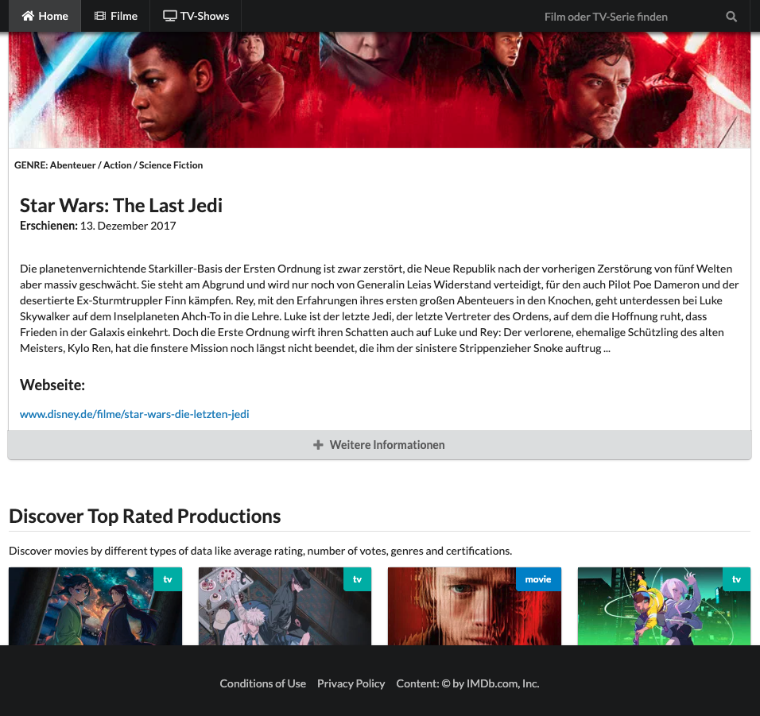

# TMDB Stencil Frontend

A Stencil-based frontend for browsing trending movies and TV shows using [The Movie Database (TMDB)](https://www.themoviedb.org/).

TMDB API credentials are handled by a local Node.js proxy. The browser never receives the TMDB API key directly.

## Features

- **Trending overview:** Home page showing current trending movies and TV shows from TMDB.
- **Movies and TV shows:** Dedicated overview pages for movies (`/movies`) and TV shows (`/tvshows`).
- **Detail pages:** Detailed views for individual movies and TV shows via the `/details/:type/:id` route.
- **Typeahead search:** Live search with suggestions while typing.
- **Client-side routing:** Custom `app-link` and `app-outlet` components for navigation and route rendering.
- **Custom error page:** If a manually entered movie or TV show ID cannot be resolved through the TMDB API, the app displays a custom error page with an error message and a link back to the home page.
- **Reusable card components:** Consistent presentation of movie and TV show posters and search results.
- **Localized TMDB requests:** The TMDB response language can be configured using `APP_LANG`; it defaults to `de-DE`.
- **Secure TMDB access:** A local Node.js proxy keeps the TMDB API key server-side and never exposes it to the browser.
- **Protected proxy:** The proxy validates a Bearer token and only allows configured browser origins.
- **Stencil web components:** The UI is built from standards-based web components and can generally be reused outside this project.
- **Production build:** Generates a static website in the `www/` directory.



## Requirements

- Node.js 20 or newer
- npm
- A TMDB API key: [TMDB API settings](https://www.themoviedb.org/settings/api)

Use the **API Key (v3 auth)** value, not the **Read Access Token (v4 auth)**.

## Setup

1. Install dependencies:

```bash
npm install
```

2. Create your local environment file:

```bash
cp .env.example .env
```

3. Choose a proxy access token.

For local development, you can choose any non-trivial value yourself. It only has to be long enough and difficult to guess. For example:

```env
PROXY_ACCESS_TOKEN=tmdb-local_a7f3k9x2q8m4v1b6n0p5r8t3w6y9z2c4
APP_PROXY_ACCESS_TOKEN=tmdb-local_a7f3k9x2q8m4v1b6n0p5r8t3w6y9z2c4
```

For a publicly deployed proxy, generate a cryptographically random token instead:

```bash
node -e "console.log(require('node:crypto').randomBytes(32).toString('hex'))"
```

This creates a 64-character hexadecimal token with high entropy. Do not use short, obvious, or reusable values such as `test`, `123456`, your name, or a timestamp.

4. Add your credentials to `.env`:

```env
APP_API_KEY=your_tmdb_v3_api_key
PROXY_ACCESS_TOKEN=your_proxy_token
APP_PROXY_ACCESS_TOKEN=your_proxy_token
PROXY_ALLOWED_ORIGINS=http://localhost:3333
APP_LANG=de-DE
APP_API_BASE_URL=http://localhost:3001/api/tmdb
PROXY_PORT=3001
```

`PROXY_ACCESS_TOKEN` and `APP_PROXY_ACCESS_TOKEN` must contain exactly the same value.

Never commit your real `.env` file, TMDB API key, or proxy access token.

## Environment variables

| Variable                 | Required | Description                                                                              |
|--------------------------|----------|------------------------------------------------------------------------------------------|
| `APP_API_KEY`            | Yes      | TMDB API key (`API Key (v3 auth)`). Used only by the Node proxy.                         |
| `PROXY_ACCESS_TOKEN`     | Yes      | Token required by the proxy. Used only by the Node proxy.                                |
| `APP_PROXY_ACCESS_TOKEN` | Yes      | The same proxy token, embedded into the frontend build.                                  |
| `PROXY_ALLOWED_ORIGINS`  | Yes      | Comma-separated browser origins allowed to call the proxy.                               |
| `APP_LANG`               | No       | TMDB request language, for example `de-DE` or `en-US`. Defaults to `de-DE`.              |
| `APP_API_BASE_URL`       | No       | API base URL used by the Stencil frontend. Defaults to `http://localhost:3001/api/tmdb`. |
| `PROXY_PORT`             | No       | Port used by the local TMDB proxy. Defaults to `3001`.                                   |

## Development

Start both the TMDB proxy and the Stencil development server with one command:

```bash
npm run dev
```

This runs:

- `node server/tmdb-proxy.mjs`
- `stencil build --dev --watch --serve`

Press `Ctrl + C` to stop both processes.

You can also run them separately:

```bash
npm run proxy
npm start
```

## Proxy security

The proxy requires this header on every TMDB request:

```http
Authorization: Bearer your_proxy_token
```

It also only allows browser origins listed in `PROXY_ALLOWED_ORIGINS`. For local development, the Stencil dev server normally runs at `http://localhost:3333`.

### What the token protects against

The proxy token prevents other websites from calling your proxy from a browser and stops requests that do not provide the expected token. This protects your TMDB quota from casual or automated third-party use.

### What the token does not do

The proxy token is **not a true server-side secret**. Because the frontend must send it with every request, it is visible in the built frontend bundle and in browser developer tools.

Therefore:

- It is sufficient as a basic protection for a local development proxy.
- It is useful as a first barrier for a public proxy.
- It does not replace real user authentication, sessions, short-lived backend-issued tokens, or rate limiting.
- Anyone who inspects your deployed frontend can extract the token and call the proxy directly.

The TMDB API key itself remains server-side only. It is never included in browser bundles, browser requests, or browser caches.

## Production build

Build the frontend for production:

```bash
npm run build
```

The deployable static website is generated in `www/`.

Before building for production, configure:

```env
APP_API_BASE_URL=https://your-proxy-domain.example/api/tmdb
APP_PROXY_ACCESS_TOKEN=your_production_proxy_token
PROXY_ALLOWED_ORIGINS=https://your-frontend-domain.example
```

The production frontend does not need or receive `APP_API_KEY`; the proxy adds it server-side.

## TMDB proxy

The proxy is implemented in `server/tmdb-proxy.mjs`.

It forwards requests such as:

```text
/api/tmdb/trending/all/week
```

to TMDB:

```text
https://api.themoviedb.org/3/trending/all/week
```

and appends your `APP_API_KEY` as the TMDB `api_key` parameter.

For production, deploy the proxy separately and configure `APP_API_KEY`, `PROXY_ACCESS_TOKEN`, and `PROXY_ALLOWED_ORIGINS` as environment variables or secrets in your hosting provider.

# Stencil Component Starter

This project is based on the [Stencil Component Starter](https://github.com/ionic-team/stencil-component-starter).

Stencil is a compiler for building fast web apps using Web Components. It generates standards-based Web Components that work in any major framework or without a framework.

## Naming Components

When creating new component tags, avoid using `stencil` in the component name, for example `<stencil-datepicker>`. Use a project- or company-specific prefix instead.

## TODO

### Architecture and maintenance

- [x] Add type-safe route definitions, route parameters, and route rendering.
- [x] Show the not-found page when a detail route contains an unsupported media type.
- [ ] Improve TypeScript type safety for TMDB API responses, store state, and media details.
- [ ] Remove remaining `any` types and introduce discriminated movie and TV show types.
- [ ] Review the Stencil migration guide and migrate the project to the current Stencil release.
- [ ] Improve error handling for network failures and unexpected API responses.
- [ ] Preserve loaded trending, movie, and TV show results when navigating between routes.
- [ ] Deduplicate paginated TMDB results by media type and TMDB ID to prevent duplicate cards when trending data changes between page requests.

### Testing and quality

- [ ] Add unit tests for utility functions, the fetch service, and store logic.
- [ ] Add component tests for search, cards, routing, and the custom error page.
- [ ] Add end-to-end tests for browsing trending content, searching, opening details, and handling invalid IDs.
- [ ] Improve accessibility, including keyboard navigation, focus management, ARIA attributes, and screen-reader announcements.

### User experience

- [ ] Add loading and empty states for search results, overview pages, and detail pages.
- [ ] Add responsive design improvements and test common screen sizes, including a mobile navigation menu.
- [ ] Add internationalization support beyond the TMDB request language, including UI labels and date and number formatting.

### Documentation

- [ ] Document the component API, project architecture, and local development workflow in more detail.
