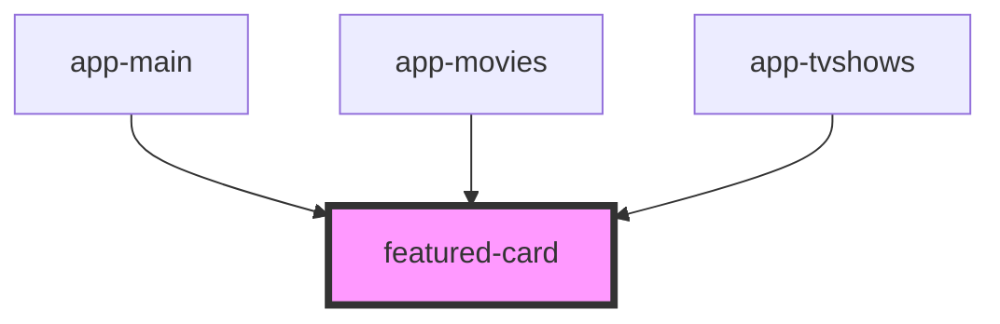

# featured-card

<!-- Auto Generated Below -->

## Properties

| Property    | Attribute    | Description | Type     | Default     |
| ----------- | ------------ | ----------- | -------- | ----------- |
| `elementId` | `element-id` |             | `string` | `undefined` |
| `mediaType` | `media-type` |             | `string` | `undefined` |

## Methods

### `goTo(event: MouseEvent, route: string) => Promise<void>`

#### Returns

Type: `Promise<void>`

## Dependencies

### Used by

 - [app-main](../../pages/app-main)
 - [app-movies](../../pages/app-movies)
 - [app-tvshows](../../pages/app-tvshows)

### Graph

----------------------------------------------

*Built with [StencilJS](https://stenciljs.com/)*
