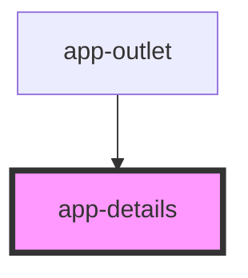

# app-details

<!-- Auto Generated Below -->

## Properties

| Property    | Attribute    | Description | Type     | Default     |
| ----------- | ------------ | ----------- | -------- | ----------- |
| `elementId` | `element-id` |             | `string` | `undefined` |
| `mediaType` | `media-type` |             | `string` | `undefined` |

## Dependencies

### Used by

 - [app-outlet](../..)

### Graph

----------------------------------------------

*Built with [StencilJS](https://stenciljs.com/)*
