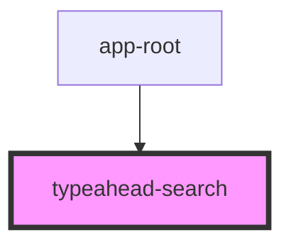

# typeahead-search

<!-- Auto Generated Below -->

## Methods

### `getSearchResult(term: string) => Promise<void>`

#### Returns

Type: `Promise<void>`

### `goTo(event: MouseEvent, route: string) => Promise<void>`

#### Returns

Type: `Promise<void>`

### `onSearchInput(value: string) => Promise<void>`

#### Returns

Type: `Promise<void>`

## Dependencies

### Used by

 - [app-root](..)

### Graph

----------------------------------------------

*Built with [StencilJS](https://stenciljs.com/)*
