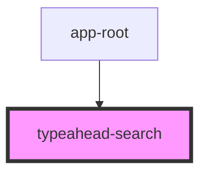

# typeahead-search

<!-- Auto Generated Below -->

## Properties

| Property  | Attribute | Description | Type            | Default     |
| --------- | --------- | ----------- | --------------- | ----------- |
| `history` | --        |             | `RouterHistory` | `undefined` |

## Methods

### `getSearchResult(term: string) => Promise<void>`

#### Returns

Type: `Promise<void>`

### `goTo(e: any, route: any, data: any) => Promise<void>`

#### Returns

Type: `Promise<void>`

### `onSearchInput(val: string) => Promise<void>`

#### Returns

Type: `Promise<void>`

## Dependencies

### Used by

 - [app-root](..)

### Graph

----------------------------------------------

*Built with [StencilJS](https://stenciljs.com/)*
